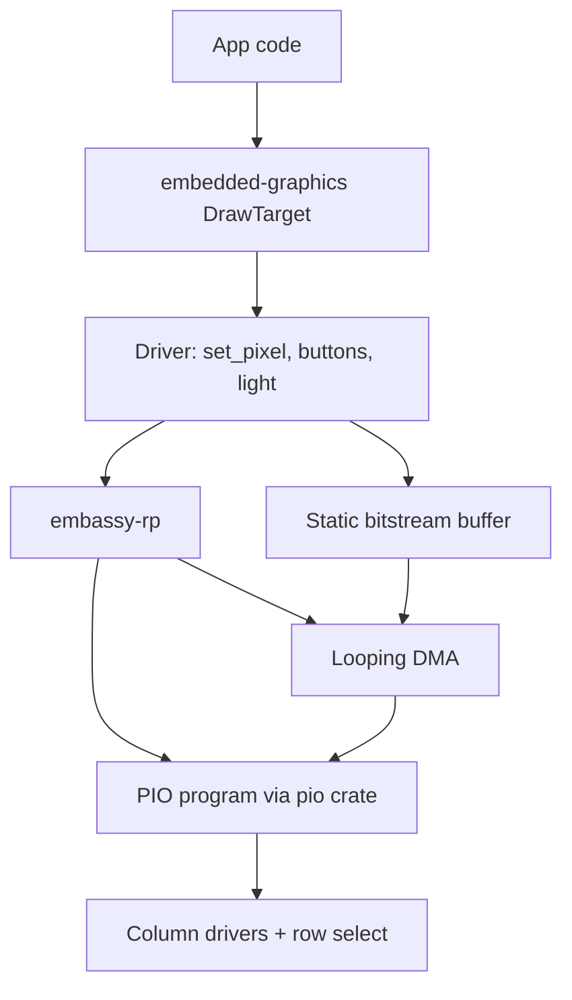
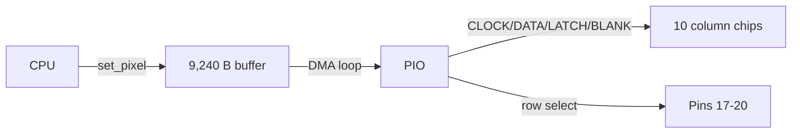
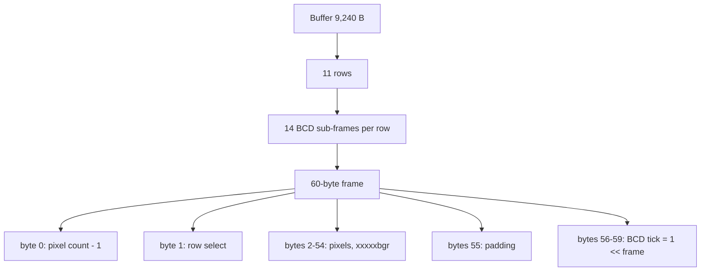

# Galactic Unicorn driver: port to Rust

- **Board:** RP2350 (Pico 2 W)
- **Decision:** port the driver, don't use FFI
- **Source:** [pimoroni-pico](https://github.com/pimoroni/pimoroni-pico) → `libraries/galactic_unicorn` (b41010d)

## Why not FFI

- The "C SDK" is C++ (`pimoroni::GalacticUnicorn`) on pico-sdk
- pico-sdk and embassy-rp both want startup, clocks, interrupts, `pio0`, DMA and `DMA_IRQ_0`
- Build would need CMake + Arm GCC + Cargo

## Target stack

## Display pipeline

- `set_pixel()` only writes the buffer (brightness + gamma applied first)
- Two chained DMA channels loop the buffer into the PIO forever
- PIO shifts pixels out and selects rows with no CPU involved

## Bitstream layout

- 11 rows × 14 BCD sub-frames × 60 bytes = **9,240 bytes**

## Pins

| Group       | Pins                                   |
| ----------- | -------------------------------------- |
| Column      | CLOCK 13, DATA 14, LATCH 15, BLANK 16  |
| Row select  | 17, 18, 19, 20                         |
| Light (ADC) | 28                                     |
| Switches    | A 0, B 1, C 3, D 6, SLEEP 27           |
| Vol / Bri   | VOL+ 7, VOL− 8, BRIGHT+ 21, BRIGHT− 26 |
| Audio (skip)| MUTE 22, I2S 9/10/11, I2C 4/5          |

## Port order

1. Fill the buffer with row selects and BCD timing values
2. Bit-bang driver-chip config `0b1111111111001110` (full current)
3. Start PIO + looping DMA
4. `set_pixel`, then `is_pressed` and `light()`
5. Audio: later

## References

- C++ source and `.pio` file in the repo above
- [Schematic](https://cdn.shopify.com/s/files/1/0174/1800/files/galactic_unicorn_schematic.pdf?v=1667910096)
- [embassy-rp](https://docs.embassy.dev/embassy-rp/) · [pio crate](https://docs.rs/crate/pio/latest) · [embedded-graphics](https://docs.rs/embedded-graphics)
