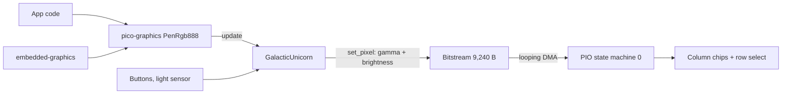
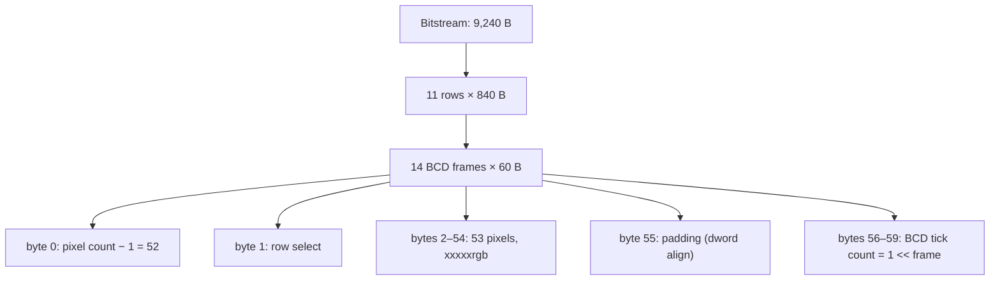

# Galactic Unicorn driver (Rust)

Rust port of Pimoroni's `galactic_unicorn` for the RP2350 (Pico 2 W). Crate: `crates/galactic-unicorn`.
Mirrors the C++ [README](../ref-impl/libraries/galactic_unicorn/README.md) topic by topic.

- **Display:** 53×11 RGB LEDs, driven by the PIO
- **Gamma + precision:** gamma-corrected, refreshed with 14-bit precision (binary-coded modulation)
- **Refresh:** the C++ README claims about 300 fps on RP2040; the port runs the same PIO program and has not been measured
- **Drawing:** via [`pico-graphics`](pico-graphics.md), then `update()`
- **Not ported:** audio ([why](#audio))

## How it fits together



Once started, the CPU is not involved in refreshing the display. It only writes the bitstream.

## Getting started

```rust
bind_interrupts!(struct Irqs {
    PIO0_IRQ_0 => pio::InterruptHandler<PIO0>;
});

let p = embassy_rp::init(Default::default());
let pio = Pio::new(p.PIO0, Irqs);
let mut unicorn = GalacticUnicorn::new(galactic_unicorn::peripherals!(p, pio));
unicorn.set_brightness(0.5);

let mut graphics = PenRgb888::<WIDTH, HEIGHT>::new();
graphics.set_pen_rgb(255, 255, 0);
graphics.set_pixel(Point::new(10, 5));
unicorn.update(&graphics);
```

- A complete program is `src/main.rs` (rainbow plus a sweeping dot, logging over USB serial)
- `GalacticUnicorn::new` replaces C++ `init()`. It is a **singleton**: a second call panics
- `peripherals!` moves the pins, DMA channels, ADC and PIO into the driver
- Flash with `./scripts/run.sh` (see [Flashing](../README.md#flashing))

## Interleaved framebuffer

The PIO has no random memory access and almost no branching. It can only process a stream in order. So the framebuffer is **interleaved**: each BCD frame is delivered one after another, with the row, pixel count and timing values inserted where the PIO program needs them.



| Bytes | Content                                         |
| ----- | ----------------------------------------------- |
| 0     | pixel count minus one (52)                      |
| 1     | row select (0–10)                               |
| 2–54  | one byte per pixel: bit 0 blue, 1 green, 2 red  |
| 55    | dummy byte                                      |
| 56–59 | BCD delay ticks, little endian, `1 << frame`    |

- **Gamma:** each channel goes through a 256-entry table to 14 bits. Bit *n* of the result is written into BCD frame *n*
- **Brightness:** applied before gamma as `(channel × brightness) >> 8`, with brightness in `0..=256`
- **Flip:** coordinates are mirrored (`x → 52 − x`, `y → 10 − y`) to match how the panel is wired
- **Note:** the C++ README's byte table says pixels are at 1–53 and row select at 56. The C++ *code* (and this port) uses the layout above

You do not need to worry about any of this when using the driver. The layout lives in `bitstream.rs`, which is pure Rust and unit-tested on the host.

## Function reference

### System state

| C++                        | Rust                                  | Status |
| -------------------------- | ------------------------------------- | ------ |
| `init()`                   | `GalacticUnicorn::new(peripherals)`   | ✅     |
| `set_brightness(f32)`      | `set_brightness(f32)`                 | ✅     |
| `get_brightness()`         | `brightness()`                        | ✅     |
| `adjust_brightness(f32)`   | `adjust_brightness(f32)`              | ✅     |
| `set_volume(f32)`          | –                                     | ❌ audio |
| `get_volume()`             | –                                     | ❌ audio |
| `adjust_volume(f32)`       | –                                     | ❌ audio |
| `light()`                  | `light()`                             | ✅     |
| `is_pressed(button)`       | `is_pressed(Button)`                  | ✅     |

- **Brightness:** clamped to `0.0..=1.0`. It applies to pixels written *after* the call, so redraw to see the change
- **`light()`:** `0..=4095`, from the ADC on GPIO 28 (blocking read). Returns `0` if the read fails

```rust
unicorn.set_brightness(0.5);
unicorn.adjust_brightness(0.1);  // 0.6
unicorn.adjust_brightness(0.7);  // 1.0
unicorn.adjust_brightness(-0.2); // 0.8
```

### Buttons

C++ passes a GPIO number; Rust uses the `Button` enum.

| `Button`         | GPIO | C++ constant            |
| ---------------- | ---- | ----------------------- |
| `A`              | 0    | `SWITCH_A`              |
| `B`              | 1    | `SWITCH_B`              |
| `C`              | 3    | `SWITCH_C`              |
| `D`              | 6    | `SWITCH_D`              |
| `Sleep`          | 27   | `SWITCH_SLEEP`          |
| `VolumeUp`       | 7    | `SWITCH_VOLUME_UP`      |
| `VolumeDown`     | 8    | `SWITCH_VOLUME_DOWN`    |
| `BrightnessUp`   | 21   | `SWITCH_BRIGHTNESS_UP`  |
| `BrightnessDown` | 26   | `SWITCH_BRIGHTNESS_DOWN`|

- Active low with pull-ups; `is_pressed` is true while held
- Brightness, sleep and volume buttons are **not** tied to hardware functions. They are software-only, so you can use them for anything

```rust
while !unicorn.is_pressed(Button::A) {}
info!("We did it! We pressed switch A! Heck yeah!");
```

### Drawing

| C++                             | Rust                          | Status |
| ------------------------------- | ----------------------------- | ------ |
| `update(PicoGraphics*)`         | `update(&PenRgb888<53, 11>)`  | ⚠️ RGB888 only |
| `clear()`                       | `clear()`                     | ✅     |
| `set_pixel(x, y, r, g, b)`      | `set_pixel(x, y, r, g, b)`    | ✅     |

- **`update`:** the recommended way to draw. It copies the framebuffer into the bitstream with gamma applied. Keep several framebuffers and switch by passing a different one. The C++ version also accepts RGB565, RGB332, P8 and P4 buffers; the port has only RGB888 (see [pico-graphics](pico-graphics.md))
- **`set_pixel`:** `x` in `0..53`, `y` in `0..11`; out of range is ignored. Colour is `0..=255` per channel, gamma corrected automatically. It shows from the next frame, so when drawing a full image keep the time between calls short to avoid scanning artefacts
- **`clear`:** turns the display off from the next frame. Unnecessary if you `update` the whole display anyway

### Audio

❌ **Not ported.** The C++ driver has `play_sample`, `synth_channel`, `play_synth`, `stop_playing` and the volume calls. They need:

- the `audio_i2s.pio` program and a second DMA channel with an IRQ
- the `pico_synth` library (ADSR voice channels)
- the MUTE pin (GPIO 22) and I2S pins (9, 10, 11)

Planned for later: [Port order](driver-port.md#port-order) step 5.

### Constants

| C++                           | Rust                                        |
| ----------------------------- | ------------------------------------------- |
| `GalacticUnicorn::WIDTH` (53) | `galactic_unicorn::WIDTH`, `GalacticUnicorn::WIDTH`  |
| `GalacticUnicorn::HEIGHT` (11)| `galactic_unicorn::HEIGHT`, `GalacticUnicorn::HEIGHT` |

```rust
let num_pixels = WIDTH * HEIGHT;
```

Pin numbers are fixed by the hardware and listed in [driver-port.md](driver-port.md#pins).

## Differences from the C++ driver

| Topic         | C++                                  | Rust                                      |
| ------------- | ------------------------------------ | ----------------------------------------- |
| Setup         | `init()` can be called again         | `new()` once; second call panics          |
| Teardown      | destructor aborts DMA, frees PIO     | none; the driver lives for the program    |
| Peripherals   | claimed by number at runtime         | moved in through `Peripherals`            |
| Buffer writes | plain stores                         | volatile stores (DMA reads concurrently)  |
| Buttons       | GPIO number                          | `Button` enum                             |
| Delays        | `sleep_ms` / `sleep_us`              | `embassy_time::block_for`                 |
| Chip          | RP2040                               | RP2350 (same PIO program)                 |

## Tests

- `bitstream.rs` is tested on the host: header and ticks, channel-to-bit mapping, brightness, bounds
  - `cargo test -p galactic-unicorn --target aarch64-apple-darwin`
- The PIO and DMA code can only be checked on the board
