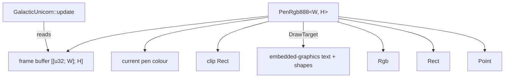

# Pico Graphics (Rust)

Rust port of the subset of Pimoroni's `pico_graphics` the Galactic Unicorn needs. Crate: `crates/pico-graphics`.
Mirrors the C++ [README](../ref-impl/libraries/pico_graphics/README.md) topic by topic.

- **Scope:** the RGB888 pen only, plus `Rect`, `Point` and `Rgb`
- **Text and shapes:** not reimplemented. Use [`embedded-graphics`](https://docs.rs/embedded-graphics) through the `DrawTarget` impl
- **Hardware:** none. The crate is `no_std` and its tests run on the host

## Overview



Your buffer does not have to be native to the display. The C++ library converts between formats on the fly; the port keeps one format, so no conversion is needed.

### Pen types

| C++ pen                | Rust      | Notes                                   |
| ---------------------- | --------- | --------------------------------------- |
| `Pen1Bit`, `Pen1BitY`  | ❌        | monochrome displays                     |
| `Pen3Bit`              | ❌        | Inky Frame                              |
| `PenP4`, `PenP8`       | ❌        | paletted                                |
| `PenRGB332`            | ❌        |                                         |
| `PenRGB565`            | ❌        |                                         |
| `PenRGB888`            | ✅ `PenRgb888` | 24-bit, stored as `u32` `0x00RRGGBB` |
| `PenInky7` and others  | ❌        | e-ink and DVI                           |

### Creating a Pico Graphics instance

C++ takes the size at runtime and allocates; Rust takes it as const generics and needs no allocator.

```rust
// C++: PicoGraphics_PenRGB888 graphics(WIDTH, HEIGHT, nullptr);
let mut graphics = PenRgb888::<53, 11>::new();
```

Then hand it to the display driver, which reads the buffer:

```rust
// C++: galactic_unicorn.update(&graphics);
unicorn.update(&graphics);
```

## Function reference

### Types

#### `Rect`

Fields `x`, `y`, `w`, `h`. The right and bottom edges are exclusive.

| C++                          | Rust                       | Status |
| ---------------------------- | -------------------------- | ------ |
| `Rect(x, y, w, h)`           | `Rect::new(x, y, w, h)`    | ✅     |
| `Rect(Point tl, Point br)`   | –                          | ❌     |
| `empty()`                    | `is_empty()`               | ✅     |
| `contains(Point)`            | `contains(Point)`          | ✅     |
| `contains(Rect)`             | –                          | ❌     |
| `intersects(Rect)`           | `intersects(Rect)`         | ✅     |
| `intersection(Rect)`         | `intersection(Rect)`       | ✅     |
| `inflate(i32)`, `deflate(i32)` | –                        | ❌     |

#### `Point`

| C++                | Rust                     | Status |
| ------------------ | ------------------------ | ------ |
| `Point(x, y)`      | `Point::new(x, y)`       | ✅     |
| `clamp(Rect)`      | `clamp(Rect)`            | ✅     |
| `+`, `-`           | `+`, `-`                 | ✅     |
| `/`, unary `-`     | –                        | ❌     |

```rust
let cursor = Point::new(10, 1000);          // far outside the screen
let cursor = cursor.clamp(graphics.bounds); // clamp to the screen
```

`clamp` returns the clamped point (it does not change the original). The C++ README example discards that return value, so it does nothing as written.

#### `Rgb`

| C++ (`RGB`)                      | Rust                       | Status |
| -------------------------------- | -------------------------- | ------ |
| `RGB(r, g, b)`                   | `Rgb::new(r, g, b)`        | ✅ channels are `u8`, not `i16` |
| `RGB(uint c)` / `to_rgb888()`    | `from_rgb888` / `to_rgb888`| ✅     |
| `from_hsv(h, s, v)`              | `from_hsv(h, s, v)`        | ✅     |
| `blend(RGB, alpha)`              | `blend(Rgb, alpha)`        | ✅     |
| `luminance()`                    | `luminance()`              | ✅     |
| `distance()`, `closest()`        | –                          | ❌ palette matching |
| RGB332, RGB565, RGB555 conversions | –                        | ❌     |

### Pens and clipping

| C++                              | Rust                          | Status |
| -------------------------------- | ----------------------------- | ------ |
| `set_pen(uint c)`                | `set_pen(u32)`                | ✅     |
| `set_pen(r, g, b)`               | `set_pen_rgb(r, g, b)`        | ✅     |
| `create_pen(r, g, b)`            | `create_pen(r, g, b)`         | ✅     |
| `create_pen_hsv(h, s, v)`        | `create_pen_hsv(h, s, v)`     | ✅     |
| `set_clip(Rect)`                 | `set_clip(Rect)`              | ✅     |
| `remove_clip()`                  | `remove_clip()`               | ✅     |

- **Pen:** in RGB888 a "pen" is the packed colour itself. `create_pen` just packs it, and there is no palette index to manage
- **Clip:** drawing is clipped to `bounds` by default, since it is impossible to draw outside the buffer. `set_clip` narrows it further (to the intersection with `bounds`)

### Palette

❌ **Not applicable.** `update_pen`, `reset_pen`, `get_palette` and `get_palette_size` exist for the paletted pens (P4, P8, RGB332). RGB888 stores every colour directly.

### Pixels

| C++                        | Rust                          | Status |
| -------------------------- | ----------------------------- | ------ |
| `pixel(Point)`             | `set_pixel(Point)`            | ✅ renamed |
| `pixel_span(Point, len)`   | `set_pixel_span(Point, len)`  | ✅ renamed |

- Both are clipped. A span is drawn rightwards from the point
- The C++ README calls these `pixel` and `pixel_span`; the C++ header calls them `set_pixel` and `set_pixel_span`. The port uses the header names

### Primitives

| C++                       | Rust                             | Status |
| ------------------------- | -------------------------------- | ------ |
| `rectangle(Rect)`         | `rectangle(Rect)`                | ✅     |
| `clear()`                 | `clear()`                        | ✅ fills the clip with the pen |
| `circle(Point, radius)`   | `embedded_graphics` `Circle`     | via `DrawTarget` |
| `line`, `triangle`, `polygon` | `embedded_graphics` primitives | via `DrawTarget` |
| `thickness`, `set_thickness`  | –                            | ❌     |

### Text

❌ Not ported (`text`, `measure_text`, `set_font`, bitmap and Hershey fonts). Use `embedded-graphics` text with a `MonoTextStyle`:

```rust
let style = MonoTextStyle::new(&FONT_6X10, Rgb888::WHITE);
Text::new("Hi", embedded_graphics::geometry::Point::new(12, 8), style)
    .draw(&mut graphics)?;
```

- `DrawTarget::draw_iter` uses the colour of each pixel and **leaves the pen unchanged**
- Draw calls from `embedded-graphics` are clipped the same way as native ones

### Change font

❌ Not applicable; choose a different `embedded-graphics` font in the style.

## Not ported

- Other pen types and their frame conversion (`frame_convert`)
- Layers (`set_layer`) and dithering (`set_pixel_dither`)
- Alpha (`set_pixel_alpha`, `render_tile`) and sprites
- Display rotation and `set_dimensions` / `set_framebuffer`
- Text, fonts and the extra primitives above

## Tests

- 12 unit tests plus 3 doc tests, all on the host: `cargo test -p pico-graphics --target aarch64-apple-darwin`
- The crate doc example draws a rectangle, a pixel and text into a 53×11 buffer and checks the result
