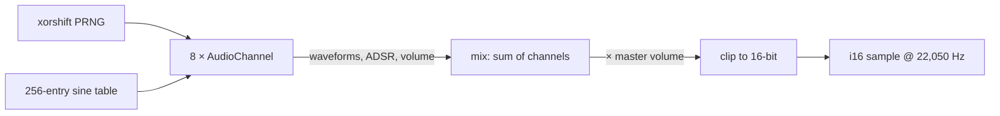
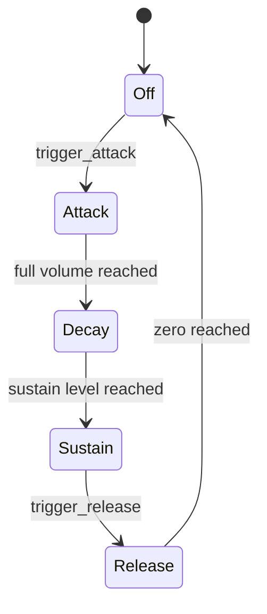

# Pico Synth (Rust)

Rust port of Pimoroni's `pico_synth`. Crate: `crates/pico-synth`.
The C++ library has no README of its own; this follows its header (`pico_synth.hpp`).

- **What:** an 8-voice synthesiser with ADSR envelopes, similar in spirit to the C64's SID chip
- **Output:** mono 16-bit samples at **22,050 Hz**, one per call to `get_audio_frame()`
- **Hardware:** none. The crate is `no_std`, and its tests run on the host
- **Used by:** [`galactic-unicorn`](galactic-unicorn.md#audio), which feeds the samples to the amplifier

## Overview



## Envelope

The length and shape of a note come from attack, decay, sustain and release, plus how long you hold the note.



| Field        | Meaning                                                   |
| ------------ | --------------------------------------------------------- |
| `attack_ms`  | milliseconds to reach full volume                         |
| `decay_ms`   | milliseconds to settle to the sustain level               |
| `sustain`    | level held until released, `0..=65535`                    |
| `release_ms` | milliseconds to fade to zero once the note ends           |

The C++ header says attack and decay "cannot be zero" because it divides by them. The port treats zero as an instant phase instead of dividing by zero.

## Waveforms

Set `waveforms` to one or more of these, combined with `|`. Enabled waveforms are averaged.

| `Waveform`  | Value | What                                                 |
| ----------- | ----- | ---------------------------------------------------- |
| `NOISE`     | 128   | random, new value each waveform period               |
| `SQUARE`    | 64    | duty cycle set by `pulse_width` (default 50%)        |
| `SAW`       | 32    | sawtooth                                             |
| `TRIANGLE`  | 16    | triangle                                             |
| `SINE`      | 8     | from a 256-entry table                               |
| `WAVE`      | 1     | your own 64-sample `wave_buffer`                     |

`WAVE` calls `wave_buffer_callback` each time the buffer has been played through, so you can refill it.

## Function reference

### `PicoSynth`

| C++                      | Rust                      | Status |
| ------------------------ | ------------------------- | ------ |
| `volume` (default 0x2fff)| `volume`                  | ✅     |
| `channels[8]`            | `channels`                | ✅     |
| `CHANNEL_COUNT`          | `PicoSynth::CHANNEL_COUNT`| ✅     |
| `get_audio_frame()`      | `get_audio_frame()`       | ✅     |
| `is_audio_playing()`     | `is_audio_playing()`      | ✅     |

### `AudioChannel`

| C++                         | Rust                          | Status |
| --------------------------- | ----------------------------- | ------ |
| `waveforms`, `frequency`, `volume` | same                   | ✅     |
| `attack_ms`, `decay_ms`, `sustain`, `release_ms` | same     | ✅     |
| `pulse_width`, `noise`      | same                          | ✅     |
| `wave_buffer`, `wave_buf_pos` | same                        | ✅     |
| `wave_buffer_callback`      | `Option<fn(&mut AudioChannel)>` | ✅   |
| `user_data` (`void *`)      | `usize`                       | ⚠️ not a pointer |
| `trigger_attack/decay/sustain/release`, `off` | same        | ✅     |
| `restore()`                 | `restore()`                   | ✅     |
| `filter_*`                  | present, unused               | ⚠️ unused in C++ too |
| `ADSRPhase`                 | `AdsrPhase`                   | ✅     |

```rust
let mut synth = PicoSynth::new();
let c = &mut synth.channels[0];
c.waveforms = Waveform::SINE;
c.frequency = 440;
c.attack_ms = 10;
c.trigger_attack();
let sample: i16 = synth.get_audio_frame();
```

## Differences from the C++

| Topic          | C++                            | Rust                                       |
| -------------- | ------------------------------ | ------------------------------------------ |
| PRNG           | one global xorshift state      | one state per `PicoSynth` (same seed)      |
| Zero ms phases | divides by zero                | instant phase (step 0)                     |
| `Waveform`     | `enum` of bit values           | `u8` constants, combined with `\|`         |
| Arithmetic     | C integer promotion            | explicit `i32`/`i64`/`u32`, same results   |

## Tests

- 10 unit tests and a doc test on the host: `cargo test -p pico-synth --target aarch64-apple-darwin`
- They cover the envelope order and sustain level, waveform output, clipping, master volume, the wave callback and noise determinism
- What they cannot check is how it *sounds*; that needs the board
